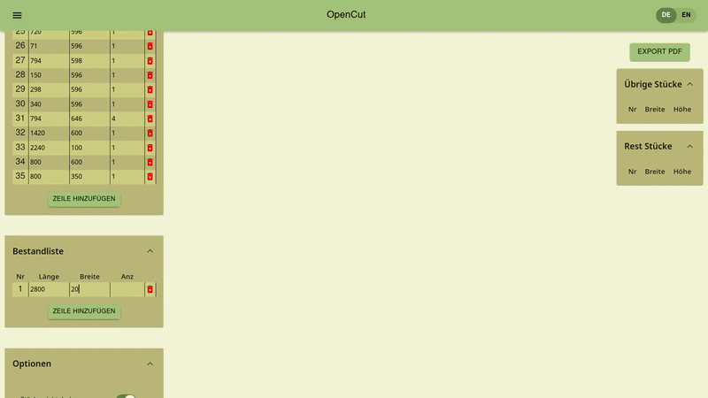
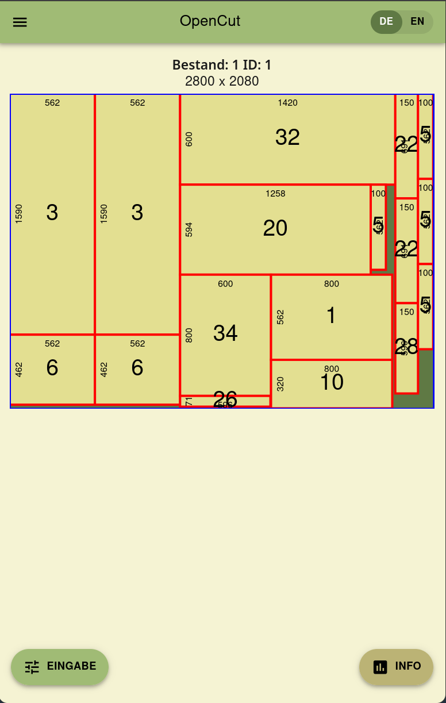

<div align="center">


# OpenCutter

**Open-source 2D rectangular guillotine cutting stock optimizer for woodworkers,
makers, and other**

[](LICENSE)
[](https://hub.docker.com/r/clpter/opencutter)
[](API)
[](Website)
[](Website)

[Live Demo](https://opencutter.com) • [Quick Start](#quick-start) •
[API Documentation](API/README.md) • [Frontend Documentation](Website/README.md)
• [Contributing](CONTRIBUTING.md)

</div>

---

## Overview

Built by a carpenter for the workshop: **OpenCutter** is a fast, 100%
open-source 2D panel cut optimizer that delivers clean, practical saw layouts
without paywalls, subscriptions, or accounts.

Given a list of required target pieces and available stock sheets (plywood, MDF,
sheet metal, acrylic, glass), OpenCutter computes the most material-efficient
cut layout to minimize waste.

All cuts are **guillotine cuts** (edge-to-edge straight cuts suitable for table
saws, panel saws, and shears).

<div align="center">
  
  <p><em>Cut optimization on desktop</em></p>
  <br /><br />
  
  <p><em>Cut optimization on mobile devices</em></p>
</div>

You can use OpenCutter right now! [opencutter.com](opencutter.com)

---

## Features

- **True Guillotine Cutting:** Generates practical, edge-to-edge cuts.
- **Grain Direction Awareness:**
  - **Fixed Orientation:** Respects wood veneer grain direction (pieces cannot
    be rotated).
  - **Free Orientation:** Rotates pieces 90° when beneficial to maximize yield.
- **Saw Kerf Allowance:** A cut margin to account for material lost to blade
  width.
- **Visual Cut Diagrams:** Interactive SVG preview displaying placed pieces, cut
  lines, and reusable off-cuts.
- **PDF Export:** Export cutting diagrams directly to printable PDF.
- **Mobile & Tablet Ready:** Fully responsive design with touch.
- **Spreadsheet Import:** Import piece cut lists from `.ods` (See example list
  from Tutorial View).
- **Dual Language:** Supports German and English.
- **One-Command Docker Deployment:** Production-ready container images published
  to Docker Hub.

---

## Quick Start

### Visit the public Website

[https://opencutter.com](https://opencutter.com)

### Run with Docker

You can run OpenCutter instantly with Docker Compose.

#### Option A: Using Pre-built Images (Fastest)

Download the `deploy/compose.yaml` file from the latest release and run:

```bash
# Start pre-built images
docker compose -f deploy/compose.yaml up -d
```

#### Option B: Build from Source

```bash
# Clone repository
git clone https://github.com/clpter/opencutter.git
cd opencutter

# Build and launch both API and Website
docker compose up --build -d
```

Once started, open:

- **Web UI:** [http://localhost](http://localhost) (or configured
  `WEBSITE_PORT`)
- **API Service:** [http://localhost:8080](http://localhost:8080) (or configured
  `API_PORT`)

#### Custom Host & Port Configuration

By default, Docker Compose binds both services to `127.0.0.1` (localhost). You
can customize the bind addresses and ports with environment variables:

| Variable       | Default     | Description                                                                              |
| :------------- | :---------- | :--------------------------------------------------------------------------------------- |
| `WEBSITE_HOST` | `127.0.0.1` | Bind IP for the frontend (use `0.0.0.0` for public or LAN access)                        |
| `WEBSITE_PORT` | `80`        | Host port for the frontend                                                               |
| `API_HOST`     | `127.0.0.1` | Bind IP for the API (not needed because requests are proxied internally by the frontend) |
| `API_PORT`     | `8080`      | Host port for the REST API                                                               |

Example:

```bash
# Expose the website to your LAN or public server on custom port 3000
WEBSITE_HOST=0.0.0.0 WEBSITE_PORT=3000 docker compose up -d
```

---

## Development & Contributing

Want to develop, run test suites, or run OpenCutter from source without Docker?

See our **[Contributing Guide](CONTRIBUTING.md)** for local developer setup (JDK
21, Maven, Node.js), architecture rules, and testing instructions.

---

## Repository Architecture

```text
.
├── API/                 # Spring Boot Java REST API
│   ├── src/             # Source Code
│   ├── pom.xml          # Maven build definition
│   └── Dockerfile       # Container build script
│
├── Website/             # React + TypeScript + Vite Web Application
│   ├── src/             # Source Code
│   ├── package.json     # Node dependencies & scripts
│   └── Dockerfile       # Container build script (Nginx)
│
├── deploy/
│   └── compose.yaml     # Production Docker Compose (uses published images)
│
├── docs/
│   └── assets/          # Documentation screenshots and media
│
├── compose.yaml         # Docker Compose for local build
├── CONTRIBUTING.md      # Guidelines for contributors
├── LICENSE              # GNU General Public License v3.0 (GPLv3)
└── README.md            # Project landing page
```

---

## Headless REST API

OpenCutter can be integrated via its JSON REST API:

- `POST /api/cut_1`: Fixed orientation (respects grain direction)
- `POST /api/cut_2`: Free orientation (rotates pieces 90° if needed)

---

## License

This project is licensed under the **GNU General Public License v3.0
(GPL-3.0)**. See the [LICENSE](LICENSE) file for details.
